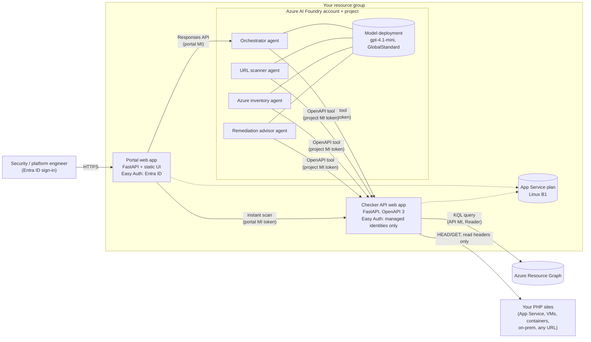
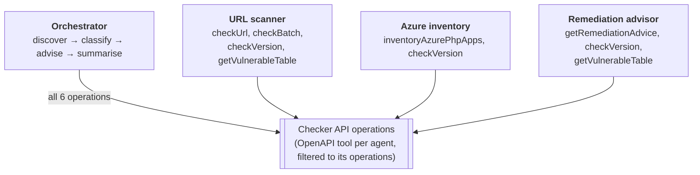
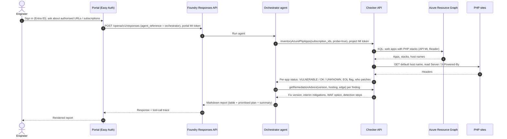
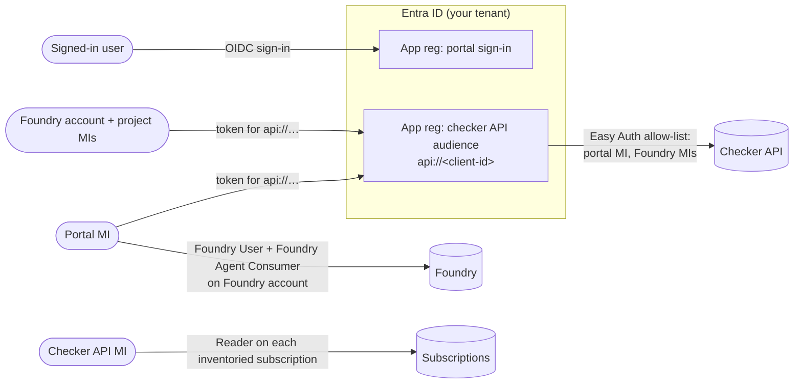
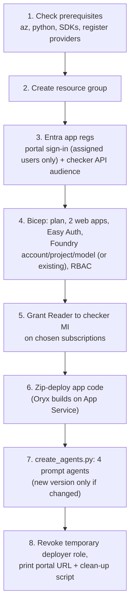

# PHP2Shell Exposure Accelerator: architecture

A deploy-your-own solution that you run **in your own Azure subscription**. It finds your PHP workloads, checks them against the PHP2Shell vulnerable-version table (CVE-2026-109618 / CVE-2026-109619), and turns the results into a prioritised remediation plan. It uses Azure AI Foundry agents, Azure Resource Graph, and two small App Service apps.

> **Scope.** The accelerator is **defensive and read-only**. It reads response headers and Azure resource metadata, compares versions, and advises. It does **not** change workloads, install patches or send exploit payloads. Patching stays a deliberate action by the workload owner, guided by the remediation plan.

## 1. Component view



| Component | Azure resource | Purpose |
|---|---|---|
| Portal | `Microsoft.Web/sites` (Python 3.12) | Sign-in UI. Runs instant scans and chats with the agents. |
| Checker API | `Microsoft.Web/sites` (Python 3.12) | Deterministic logic: header checks, version table, Resource Graph inventory, remediation rules. Exposed as an OpenAPI tool. |
| Foundry account + project | `Microsoft.CognitiveServices/accounts` (AIServices) + `/projects` | Hosts the four prompt agents and the model deployment. A new account disables local (key) auth; verify the settings when reusing an existing account. |
| Model deployment | `/accounts/deployments` | Default `gpt-4.1-mini` (GlobalStandard, 50K TPM). Any chat model in the project works. |
| App Service plan | `Microsoft.Web/serverfarms` (Linux B1) | Shared by both apps. |
| Entra app registrations (2) | Entra ID | Portal sign-in (single tenant); audience `api://…` that protects the checker API. |

## 2. Agent design



* Each agent is a Foundry **prompt agent** with one OpenAPI tool. The tool spec is filtered to only the operations that agent needs (least privilege at the tool level).
* The **orchestrator** powers the portal's *Ask the agent* tab and can call every operation. The *Multi-agent assessment* tab runs the URL scanner and Azure inventory agents in parallel, then passes their findings to the remediation advisor.
* Shared **guardrails** are appended to every agent: defensive only, no exploit content, *unknown ≠ patched*, headers are evidence not proof, cite php.net and the Azure Network Security blog.
* Classifications and remediation advice come from the **checker API code**, so they are deterministic and auditable. Agent prompts also repeat fixed-version and WAF guidance, which must be kept current with the code.

## 3. Request flow: Ask the agent



The portal's **Instant scan** tab skips the LLM and calls `/check/batch` and `/inventory/azure` on the checker API directly, so results come back in seconds.

*Ask the agent* has no ownership checkbox: only ask about systems you are authorised to assess. *Multi-agent assessment* instead runs the scanner and inventory agents in parallel after the confirmation, then calls the advisor.

## 4. Identity and access



| Principal | Role / permission | Scope | Why |
|---|---|---|---|
| Portal managed identity | Foundry User, Foundry Agent Consumer | Foundry account | Call agents through the Responses API |
| Portal managed identity | Allowed caller (Easy Auth) | Checker API | Instant scans |
| Foundry account + project managed identities | Allowed caller (Easy Auth) | Checker API | Agent tool calls |
| Checker API managed identity | **Reader** | Each subscription you choose (`-InventorySubscriptionIds`) | Resource Graph inventory. Read-only, cannot change anything |
| Deploying user | Azure AI Developer (temporary) | Foundry account | Create the agents during deployment. Revoked at the end of `deploy.ps1` if the script granted it |
| End users | Assignment to the portal's enterprise application | Portal | Only users and groups you assign can sign in (`appRoleAssignmentRequired`) |

Security controls:

* **No keys or secrets.** All service-to-service calls use managed identities. New Foundry accounts disable local authentication; verify the authentication settings when reusing an existing account.
* **Checker API is not anonymous.** App Service Authentication returns `401` unless the token's audience is `api://<checker client id>` *and* the caller is one of the allow-listed managed identities. Only `/healthz`, `/openapi.json` and `/docs` are public, and they expose no scan data.
* **Least privilege.** Reader only, only on the subscriptions you list; each agent's tool spec contains only its operations.
* **Server-side scope.** The checker API refuses inventory requests for any subscription not in `ALLOWED_SUBSCRIPTION_IDS` (set from `-InventorySubscriptionIds`), whoever asks, including the agents; the portal also checks instant scans. Anyone you assign to the portal can see the inventory of those subscriptions, so assign only people who may see them.
* **Mandatory sign-in.** The portal has no anonymous mode. Its API also refuses requests without the App Service Authentication principal headers.
* **Public destinations only (SSRF protection).** The checker resolves every hostname itself and refuses loopback, private, link-local (including `169.254.169.254`), carrier-grade NAT and other non-public addresses. It then connects to the validated IP, so DNS re-binding cannot redirect the request; TLS still validates the original hostname. Only ports 80, 443, 8080 and 8443 are allowed, proxies from the environment are ignored and redirects are not followed. For defence in depth, you can also restrict outbound traffic from the checker web app (VNet integration with an NSG or Azure Firewall).
* **Bounded work.** Responses are streamed and only the status line and headers are read; bodies are never downloaded. At most 10 probes run at once per worker process (two Gunicorn workers by default), a batch holds at most 50 URLs, and an inventory header-checks at most 200 apps. Resource Graph results are paged; if an inventory is incomplete, the response says so.
* **Untrusted tool output.** Header values are truncated and stripped of control characters, and every agent is instructed to treat tool output as data, never as instructions, and to call tools only for targets the user supplied. Instructions reduce prompt-injection risk; they don't guarantee it.
* **Configured vs advertised version.** If an app advertises a PHP branch that differs from its configured stack, the inventory flags it (`stack_mismatch`) and doesn't assign patch responsibility from the configured stack. Container apps (`DOCKER` stacks) are listed as candidates that may not run PHP.
* **HTTPS only**, TLS 1.2 minimum, FTPS disabled.
* **Ownership confirmation.** The instant scan and the multi-agent assessment run only after the user confirms that they own or are authorised to assess the targets. This is an attestation, not a technical control, and free-form questions in *Ask the agent* do not require it; the portal logs the signed-in user and the targets of every instant scan.
* **Data handling.** The instant scan does not use AI. The AI features send scan targets and findings to the Foundry agents and your model deployment. With a GlobalStandard deployment (the default), prompts and responses may be processed in any Azure region; choose a DataZone or regional deployment type if you need tighter data residency.
* **Safe probing.** The checker sends a `HEAD` (falling back to `GET` only on 405/501) with a clearly labelled user agent (`PHP2Shell-Checker-Azure/1.0 (defensive version check)`) and reads headers only. URL credentials and fragments are rejected.

## 5. Deployment flow (`deploy.ps1`)



Prerequisites for whoever runs `deploy.ps1`:

* PowerShell 7+, Azure CLI 2.60+ (with Bicep), Python 3.10+ (Windows, macOS or Linux).
* **Owner** (or Contributor + User Access Administrator) on the target resource group, because the template creates role assignments.
* Permission to create Entra ID app registrations and to assign users to enterprise applications (**Application Administrator** or **Cloud Application Administrator**, or ownership of the portal's enterprise application), and **Reader-granting rights** (User Access Administrator or Owner) on every subscription in `-InventorySubscriptionIds`.
* If the resource group is new, you also need permission to create it in the deployment subscription; registering Microsoft.Web and Microsoft.CognitiveServices requires subscription-level rights unless already registered.
* Model quota for the chosen model in `-FoundryLocation`.

On first sign-in each user sees a one-time Entra consent prompt for basic profile access to the portal app registration. An Entra admin can grant tenant-wide consent instead (Enterprise applications → the portal app → Permissions → Grant admin consent).

Example:

```powershell
./deploy.ps1 -SubscriptionId <sub-id> -ResourceGroup rg-php2shell -Location swedencentral `
             -InventorySubscriptionIds <sub-a>,<sub-b>
```

Options:

| Parameter | Default | Notes |
|---|---|---|
| `-SubscriptionId`, `-ResourceGroup` | required | Target for the deployment |
| `-Location` | `swedencentral` | App Service region |
| `-FoundryLocation` | same as `-Location` | Must offer the chosen model |
| `-ModelName` / `-ModelCapacity` | `gpt-4.1-mini` / 50 | New model deployment (GlobalStandard) |
| `-ExistingProjectEndpoint`, `-ExistingFoundryAccountId`, `-ExistingModelDeployment` | none | Reuse an existing Foundry project instead of creating one |
| `-InventorySubscriptionIds` | the deployment subscription | Subscriptions the checker may read; all others are refused |
| `-PortalUserObjectIds`, `-PortalGroupObjectIds` | none | Extra Entra users or groups allowed to sign in (you are always added). Group assignment needs Entra ID P1 |
| `-AppServiceSku` | `B1` | B1 is enough; scale up if you need more throughput |

Clean up: run the generated `cleanup-<resource-group>-<sub-id-prefix>.ps1`. `<sub-id-prefix>` is the first eight characters of the subscription ID. If the script created the resource group, clean-up deletes the entire group, including anything added to it later. In an existing group it removes only the resources the deployment recorded. It also removes the app registrations, role assignments and, in an existing Foundry project, the agents the deployment created, and it refuses to run against a different tenant. `deploy.ps1` never adopts an app registration it did not create (it stops with a message instead), and in an existing resource group it records only resources that this deployment created. `deploy.ps1` is idempotent: re-running it updates the deployment and creates new agent versions only when an agent's definition has changed.

## 6. What the accelerator classifies

| Status | Meaning | Typical action |
|---|---|---|
| **VULNERABLE** | Advertised PHP version is at or below the last vulnerable patch level of its branch (fixed releases: 8.5.12, 8.4.27, 8.3.36, 8.2.35) | P1: patch or upgrade now; add WAF rule as interim layer |
| **OK** | Advertised version is above the last vulnerable patch level | P3: verify on the server (`php -v` for the SAPI in use) |
| **UNKNOWN** | Version hidden by headers, CDN or proxy, or not a recognised release | P2: confirm on the server. *Hidden is not patched* |

End-of-life branches (8.1 and older) are flagged separately in every result: even with PHP's minimal source backports for 7.4, 8.0 and 8.1, the recommendation is to migrate to a supported branch.

Shared responsibility on Azure:

* **App Service (Linux) built-in PHP 8.2+ stacks:** the platform rolls out patched runtimes; verify the running version.
* **End-of-life stacks, App Service on Windows with custom PHP, containers, VMs, AKS:** you patch.
* **Interim WAF layer:** Front Door managed rule `99006001` (MS-ThreatIntel-Response-CVEs, DRS 2.0–2.2) is disabled by default, requires Block on anomaly, and rolls out through approximately 28 Oct 2026; contact Microsoft Support for expedited availability. Alternatively, an Application Gateway WAF v2 `Set-Cookie` rewrite rule. These supplement patching; they do not replace it.

## 7. Limits and known caveats

* Header checks are **evidence, not proof**: headers can be removed or changed, and Linux distributions backport fixes without changing the version string.
* Inventory covers **App Service** through Resource Graph. VMs, AKS and on-premises servers are checked by URL or by pasting `php -v` output.
* The accelerator is not an official Microsoft or PHP advisory. Use php.net and the Azure Network Security blog as the authoritative sources.
* Cost: one Linux B1 plan plus model tokens per assessment (an estimate of typically a few cents per run with `gpt-4.1-mini`).
