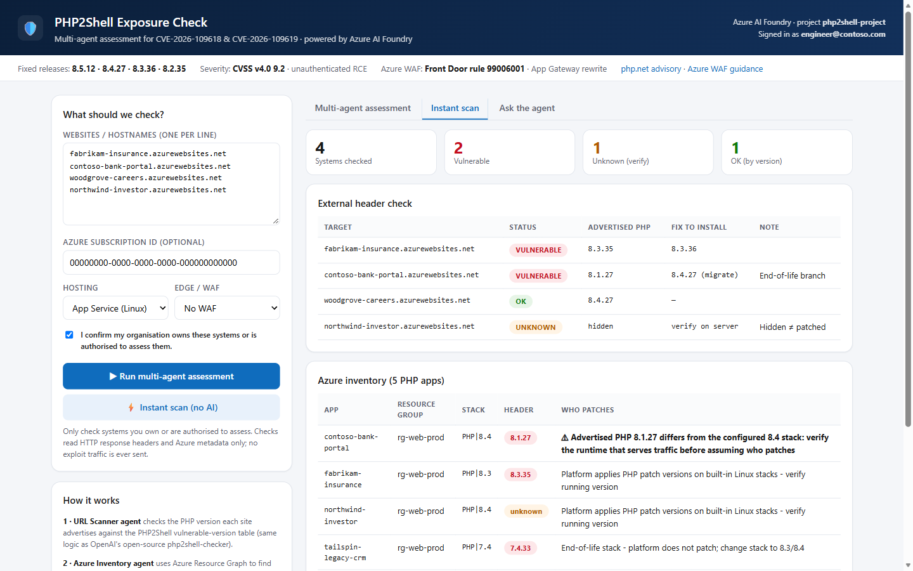

# PHP2Shell Exposure Accelerator

A deploy-your-own Azure solution that finds your PHP workloads, checks them against the PHP2Shell vulnerable-version table (CVE-2026-109618 / CVE-2026-109619), and turns the results into a prioritised remediation plan.

It uses four [Azure AI Foundry](https://learn.microsoft.com/azure/ai-foundry/) prompt agents, Azure Resource Graph and two small App Service apps, all deployed into **your own subscription** with one script.

> **Defensive and read-only.** The accelerator reads HTTP response headers and Azure resource metadata, compares versions and advises. It does **not** change workloads, install patches or send exploit payloads. Only assess systems you own or are authorised to assess.

📘 **Illustrated guide (how to use + architecture):** download [`docs/guide.html`](docs/guide.html) and open it in a browser.



## What it does

| Way to run | Uses AI | What you get |
|---|---|---|
| **Multi-agent assessment** | Yes | URL scanner and Azure inventory agents run in parallel; a remediation advisor turns their findings into a prioritised plan. |
| **Instant scan** | No | Header check for every URL plus an App Service inventory, straight from the checker API, in seconds. |
| **Ask the agent** | Yes | Conversational orchestrator agent for "what if" questions, servers outside Azure (paste `php -v`) and explaining results. |

Every system is classified as **VULNERABLE** (patch now), **UNKNOWN** (version hidden: hidden is not patched) or **OK** (verify on the server). End-of-life branches (8.1 and older) are flagged separately. Fixed releases: **8.5.12, 8.4.27, 8.3.36, 8.2.35**.

## Quick start

Prerequisites: PowerShell 7+, Azure CLI 2.60+ (with Bicep), Python 3.10+; Owner (or Contributor + User Access Administrator) on the target resource group; permission to create Entra ID app registrations and to assign users to enterprise applications (Application Administrator or Cloud Application Administrator, or ownership of the portal's enterprise application); and model quota for `gpt-4.1-mini` (or another chat model) in your region. If the resource group is new, you also need permission to create it in the deployment subscription; registering Microsoft.Web and Microsoft.CognitiveServices requires subscription-level rights unless already registered.

```powershell
az login
git clone https://github.com/dustyFski/php2shell-exposure-accelerator.git
cd php2shell-exposure-accelerator
./deploy.ps1 -SubscriptionId <sub-id> -ResourceGroup rg-php2shell -Location swedencentral `
             -InventorySubscriptionIds <sub-a>,<sub-b>
```

Only you can sign in at first; add colleagues with `-PortalUserObjectIds` / `-PortalGroupObjectIds` or under **Enterprise applications → Users and groups**. The script prints the portal URL and the agent names, and writes a `cleanup-<resource-group>-<sub-id-prefix>.ps1` script. See [ARCHITECTURE.md](ARCHITECTURE.md) for every option, the identity model and the diagrams.

## Repository layout

| Path | Contents |
|---|---|
| `deploy.ps1` | One-shot deployment (idempotent; writes a clean-up script) |
| `infra/main.bicep` | App Service plan, two web apps, Easy Auth, Foundry account / project / model, RBAC |
| `agents/create_agents.py` | Creates the four prompt agents with managed-identity OpenAPI tools |
| `src/checker-api/` | Deterministic checker API (FastAPI) and unit tests |
| `src/portal/` | Portal (FastAPI + static UI) |
| `ARCHITECTURE.md` | Architecture reference |
| `docs/guide.html` | Self-contained illustrated guide |

## Security model in brief

* No keys or secrets: every service-to-service call uses a managed identity. New Foundry accounts disable local authentication; verify the authentication settings when reusing an existing account.
* The checker API is protected by App Service Authentication and only accepts tokens from the portal and Foundry managed identities.
* The checker identity gets **Reader** only, only on the subscriptions you list, and the checker API refuses inventory requests for any other subscription.
* Portal sign-in is mandatory (single tenant) and limited to the users and groups you assign. Anyone you assign can see the inventory of the configured subscriptions.
* URL checks only reach public internet addresses on ports 80/443/8080/8443: loopback, private, link-local and metadata addresses are refused, including via DNS re-binding. Only headers are read.
* Agents are instructed to treat tool output (headers, resource names) as untrusted data.
* If an app advertises a different PHP version than its configured stack, the inventory flags it instead of assuming the platform patches it.
* The instant scan uses no AI. The AI features send scan targets and findings to your Foundry agents and model deployment; with the default GlobalStandard deployment they may be processed in any Azure region.

## Clean up

```powershell
./cleanup-<resource-group>-<sub-id-prefix>.ps1
```

`<sub-id-prefix>` is the first eight characters of the subscription ID. If the script created the resource group, clean-up deletes the entire group, including anything added to it later. In an existing group it removes only the resources the deployment recorded. It also removes the app registrations, role assignments and, in an existing Foundry project, the agents the deployment created, and it refuses to run against a different tenant.

## Disclaimer

This is a community project. It is **not** an official Microsoft or PHP advisory and is provided as-is, without warranty. Header-based checks are evidence, not proof: headers can be hidden or changed, and distributions backport fixes without changing the version string. Use [php.net](https://www.php.net/) and the Azure Network Security blog as the authoritative sources.

## License

Apache License 2.0, see [LICENSE](LICENSE). The version-check logic is derived from OpenAI's open-source [php2shell-checker](https://github.com/openai/php2shell-checker) (Apache-2.0); see [NOTICE](NOTICE).
